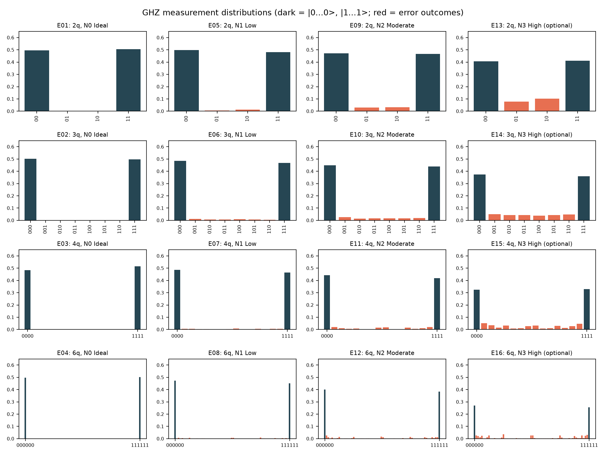
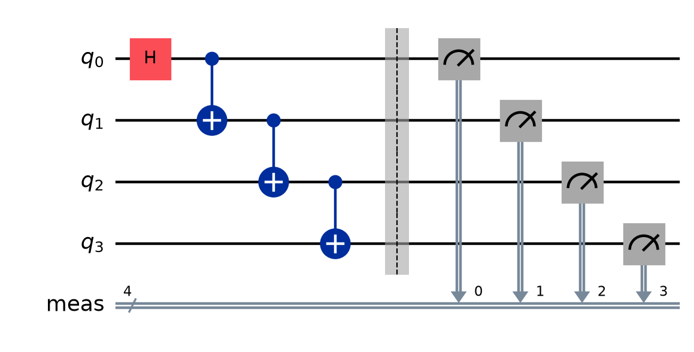
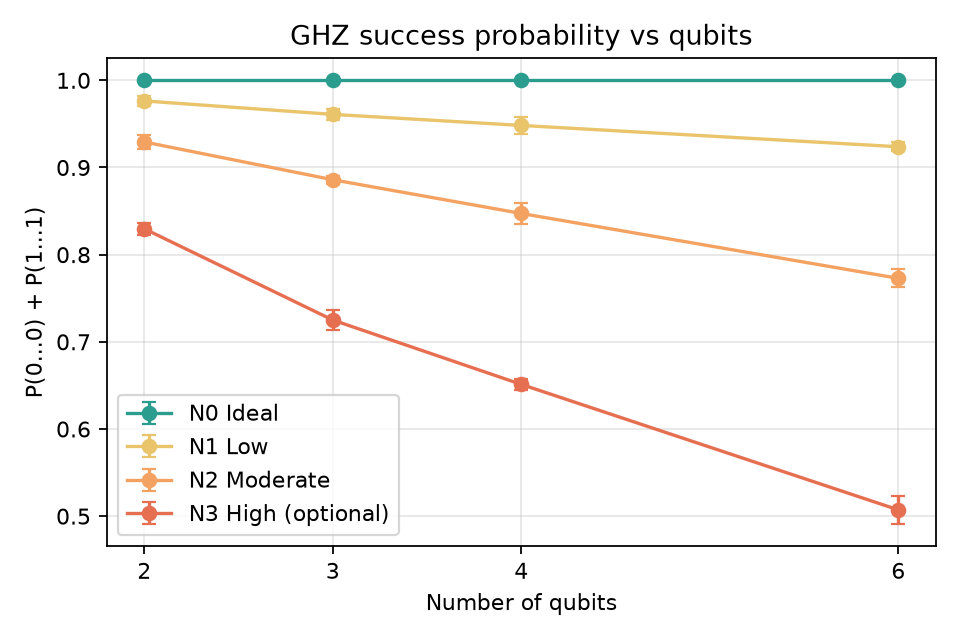
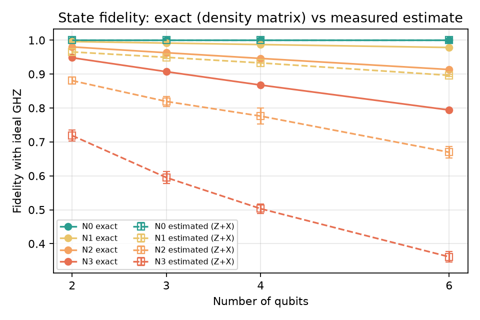
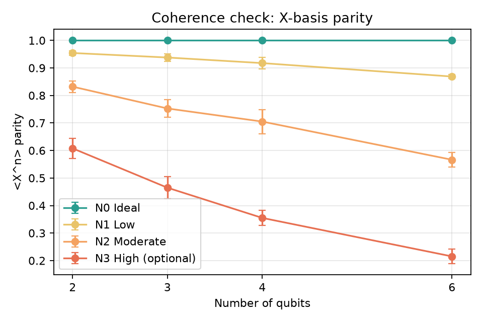
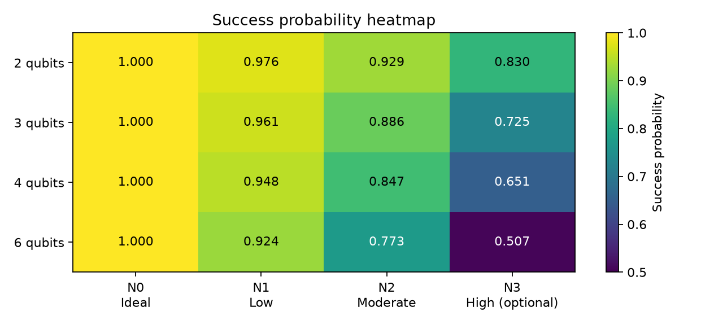
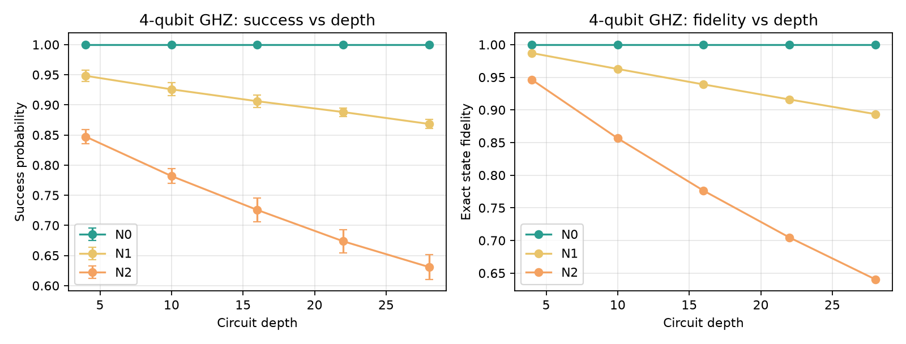
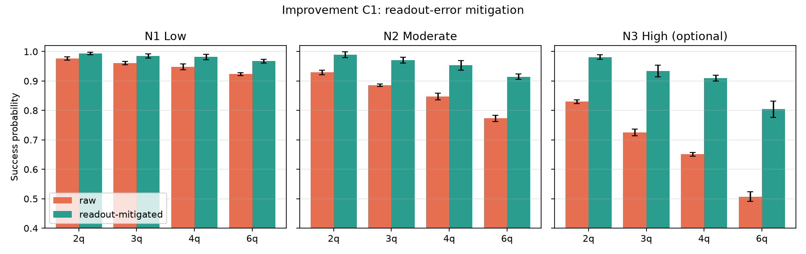
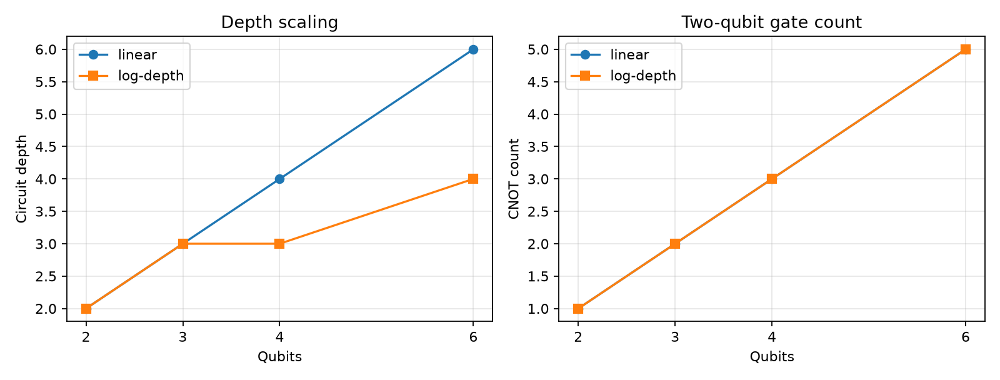

# GHZ State Generation and Noise Analysis

**Quantum Computing (23CYE732) · VII Semester · Department of CSE (Cyber Security)**
**M. S. Ramaiah Institute of Technology, Bengaluru**

| | |
|---|---|
| **Author** | Vishalaachi P P (1MS23CY075) |
| **Assignment** | Group 12: GHZ States and Noise |
| **Stack** | Python 3, Qiskit 2.6, Qiskit Aer 0.18, NumPy, Pandas, Matplotlib |
| **Report** | [`report/Group12_Quantum_Report.pdf`](report/Group12_Quantum_Report.pdf) ([.docx](report/Group12_Quantum_Report.docx)) |

---

## Contents

1. [Research question](#1-research-question)
2. [Key results](#2-key-results)
3. [Background: what a GHZ state is](#3-background-what-a-ghz-state-is)
4. [Repository layout](#4-repository-layout)
5. [Setup](#5-setup)
6. [Running the experiments](#6-running-the-experiments)
7. [Experiment design](#7-experiment-design)
8. [Noise model](#8-noise-model)
9. [Metrics](#9-metrics)
10. [Results in detail](#10-results-in-detail)
11. [Building the report](#11-building-the-report)
12. [Reproducibility](#12-reproducibility)
13. [Limitations and future work](#13-limitations-and-future-work)
14. [References](#14-references)

---

## 1. Research question

> **How does the number of qubits affect GHZ-state generation, measurement results and noise sensitivity?**

The project prepares GHZ states on 2, 3, 4 and 6 qubits and simulates them on Qiskit Aer under four noise
levels. It then measures how the output distribution, the coherence of the state and the state fidelity
degrade. Because the simulator lets gate noise and readout noise be switched separately, and returns the exact
noisy density matrix, each part of the loss can be traced to its source. Hardware experiments cannot do this.

Sub-questions:

- **RQ1:** How do success probability and fidelity change as qubit count grows?
- **RQ2:** Is coherence (X-basis parity) more fragile than computational-basis populations?
- **RQ3:** Which noise source, gate or readout, dominates, and can readout-error mitigation recover it cheaply?

## 2. Key results

| Finding | Evidence (5 seeds × 1024 shots) |
|---|---|
| Ideal GHZ is exact at every size | N0: success = fidelity = 1.000 for 2–6 qubits; depth = n, CNOTs = n−1 |
| Fidelity falls with qubit count | N2: success 0.929 (2q) → 0.773 (6q); N3: 0.830 → 0.507 |
| Coherence is more fragile than populations | 6q, N2: X-parity 0.566 vs success 0.773 |
| Readout error dominates the measured loss | 6q, N2: measured F 0.670 vs exact state F 0.913 |
| Readout mitigation recovers most of it | 6q, N2: measured F 0.670 → 0.868 for 2 extra calibration circuits |
| Depth alone costs fidelity | 4q, N2: depth 4 → 28 drops exact F 0.946 → 0.641 (~1.3 points per CNOT) |
| Log-depth construction: no gain here | 6q depth 6 → 4, fidelity unchanged; the noise model has no idle (T1/T2) errors |
| Genuine multipartite entanglement kept | Exact fidelity > 0.5 in every configuration (lowest: 0.794) |

<p align="center">
  
  <br><em>Measurement distributions for all 16 main experiments. Dark bars are GHZ outcomes |0…0⟩ and |1…1⟩; red bars are errors.</em>
</p>

## 3. Background: what a GHZ state is

A Greenberger–Horne–Zeilinger state on *n* qubits is

```
|GHZ_n⟩ = ( |00…0⟩ + |11…1⟩ ) / √2
```

It is prepared with one Hadamard and a chain of n−1 CNOTs:

```python
qc = QuantumCircuit(n)
qc.h(0)
for i in range(n - 1):
    qc.cx(i, i + 1)
```

<p align="center"></p>

An ideal GHZ state measures only all-zeros or all-ones, each with probability ½. A classical 50/50 mixture
of those two strings gives the same histogram, so the project also measures in the **X basis**: an H on every
qubit, then measure. There the parity ⟨X⊗n⟩ is 1 for a real GHZ state and 0 for a mixture.

## 4. Repository layout

```
.
├── ghz_experiments.py        # all experiments: circuits, noise models, simulation, metrics, plots, tables
├── make_report_docx.py       # fills the course Word template with the results -> report/*.docx
├── tools/
│   └── finalize_report.ps1   # Word automation: builds the table of contents and exports the PDF
├── requirements.txt
├── results/
│   ├── summary.md            # every results table in markdown
│   ├── main_results.csv      # Set A (+ C1 mitigation columns)
│   ├── depth_results.csv     # Set B
│   ├── logdepth_results.csv  # Set C2
│   ├── raw_counts.json       # every measured count, every seed, Z and X basis
│   └── environment.json      # software versions, seeds, noise parameters
├── figures/
│   ├── circuits/             # circuit diagrams (qc.draw("mpl"))
│   ├── histograms/           # one histogram per experiment (E01–E16)
│   └── fig1 … fig10          # summary plots
├── report/
│   ├── Group12_Quantum_Report.docx
│   └── Group12_Quantum_Report.pdf
├── templates/                # course report template and cover page
├── assets/                   # institute logo used in the report header
└── REPORT_OUTLINE.md         # rubric-mapped outline used while writing the report
```

## 5. Setup

Requires Python 3.10+ (developed on 3.14).

```bash
git clone https://github.com/PPViveka/Quantum-project.git
cd Quantum-project
python -m venv .venv
# Windows
.venv\Scripts\activate
# Linux / macOS
source .venv/bin/activate
pip install -r requirements.txt
```

`requirements.txt` pins `qiskit==2.6.2` and `qiskit-aer==0.18.4`. `pylatexenc` is needed for
`qc.draw("mpl")`, and `python-docx` is only needed to rebuild the Word report.

## 6. Running the experiments

```bash
python ghz_experiments.py            # full run: 5 seeds, noise N0–N3 (~20 s on a laptop CPU)
python ghz_experiments.py --quick    # 1 seed, for a fast check
python ghz_experiments.py --no-high  # skip the optional N3 stress-test level
```

The script prints one line per experiment and writes everything to `results/` and `figures/`:

```
Set A: qubits x noise
  E01  n=2  N0  success=1.000  F_exact=1.000
  ...
  E12  n=6  N2  success=0.773  F_exact=0.913
  ...
Done in 19.9s
```

## 7. Experiment design

Common settings: **Qiskit Aer `AerSimulator`, 1024 shots per circuit, seeds 11/22/33/44/55**
(reported as mean ± standard deviation).

| Set | IDs | What varies | Purpose |
|---|---|---|---|
| **A** | E01–E16 | qubits {2, 3, 4, 6} × noise {N0, N1, N2, N3} | Main matrix: 16 experiments, 2 varied parameters |
| **B** | D01–D15 | 0–4 extra CNOT layers (depth 4–28) × N0–N2, at 4 qubits | Effect of depth with the target state fixed |
| **C1** | all noisy A runs | readout mitigation off / on | Proposed improvement 1 |
| **C2** | 24 runs | linear vs log-depth construction × qubits × N0–N2 | Proposed improvement 2 |

- **Depth padding (Set B):** each extra layer undoes and redoes the CNOT chain, so the ideal state is unchanged
  while depth and CNOT count each rise by 2(n−1).
- **Log-depth GHZ (Set C2):** every qubit that is already entangled entangles a new one in each layer, so depth
  is 1 + ⌈log₂ n⌉ with the same n−1 CNOTs.
- **Readout mitigation (Set C1):** two calibration circuits (all-0, all-1) per qubit count give each qubit's flip
  rates. The tensor product of these 2×2 matrices is inverted on the measured distribution, then negative values
  are clipped and the result renormalised.

## 8. Noise model

The noise levels follow the course guidelines: depolarizing error on gates plus symmetric readout error.

| Level | Label | 1-qubit gate (H, X) | 2-qubit gate (CX) | Readout |
|---|---|---|---|---|
| N0 | Ideal | 0 | 0 | 0 |
| N1 | Low | 0.1% | 0.5% | 1% |
| N2 | Moderate | 1% | 2% | 3% |
| N3 | High (optional) | 3% | 5% | 8% |

```python
nm = NoiseModel(basis_gates=["h", "x", "cx"])
nm.add_all_qubit_quantum_error(depolarizing_error(p1, 1), ["h", "x"])
nm.add_all_qubit_quantum_error(depolarizing_error(p2, 2), ["cx"])
nm.add_all_qubit_readout_error(ReadoutError([[1 - ro, ro], [ro, 1 - ro]]))
sim = AerSimulator(noise_model=nm, seed_simulator=seed)
```

## 9. Metrics

| Metric | Definition | Ideal |
|---|---|---|
| Success probability | P(0…0) + P(1…1), Z basis | 1 |
| Hellinger fidelity | Overlap of the measured distribution with the ideal 50/50 | 1 |
| X-parity ⟨X⊗n⟩ | Σ p(b)·(−1)^\|b\| over X-basis outcomes | 1 |
| Estimated fidelity | ½ [P(0…0) + P(1…1) + ⟨X⊗n⟩]; includes readout error | 1 |
| Exact state fidelity | ⟨GHZ\|ρ\|GHZ⟩ from a density-matrix simulation; gate noise only | 1 |
| Resources | depth, total gates, CNOT count, depth with measurement | n, n, n−1 |

## 10. Results in detail

Full tables: [`results/summary.md`](results/summary.md).

### Set A: qubits × noise (selected)

| Qubits | Noise | Success P | X-parity | F estimated | F exact |
|---|---|---|---|---|---|
| 2 | N2 | 0.929 ± 0.008 | 0.832 ± 0.021 | 0.881 ± 0.010 | 0.980 |
| 4 | N2 | 0.847 ± 0.012 | 0.705 ± 0.044 | 0.776 ± 0.023 | 0.946 |
| 6 | N2 | 0.773 ± 0.010 | 0.566 ± 0.026 | 0.670 ± 0.017 | 0.913 |
| 6 | N3 | 0.507 ± 0.016 | 0.215 ± 0.027 | 0.361 ± 0.016 | 0.794 |

<p align="center">
  
  
</p>
<p align="center">
  
  
</p>

### Set B: depth at 4 qubits

<p align="center"></p>

### Set C1: readout-error mitigation

<p align="center"></p>

| Qubits | Noise | Success raw → mitigated | F est. raw → mitigated | F exact |
|---|---|---|---|---|
| 6 | N1 | 0.924 → 0.967 | 0.896 → 0.959 | 0.978 |
| 6 | N2 | 0.773 → 0.915 | 0.670 → 0.868 | 0.913 |
| 6 | N3 | 0.507 → 0.804 | 0.361 → 0.711 | 0.794 |

### Set C2: linear vs log-depth

<p align="center"></p>

The log-depth circuit is shallower but has identical fidelity, because both circuits use n−1 CNOTs and the
noise model charges errors per gate, not per unit time.

## 11. Building the report

The Word report is generated, not hand-edited, so its tables always match `results/`.

```bash
python make_report_docx.py                                         # -> report/Group12_Quantum_Report.docx
powershell -ExecutionPolicy Bypass -File tools/finalize_report.ps1 # TOC + PDF (Windows + MS Word)
```

`make_report_docx.py` fills `templates/Group12_Report_Template.docx`, prepends the cover page from
`templates/cover_page.docx`, adds the institute logo to every page header, and applies the required fonts
(Times New Roman Bold: 16 pt main headings, 14 pt subheadings, 12 pt content).

## 12. Reproducibility

- Fixed simulator seeds (`11, 22, 33, 44, 55`; X-basis runs use seed + 500, calibration runs use seed + 2000).
- `results/environment.json` records the Python, Qiskit, Aer, NumPy, Pandas and Matplotlib versions and the noise
  parameters. `results/raw_counts.json` stores every count.
- Re-running `ghz_experiments.py` with the pinned versions reproduces every number in the report exactly.
- The circuits use only the simulator basis gates `{h, x, cx}`, so the transpiled depth equals the logical depth.

## 13. Limitations and future work

- **Simulator only**, with a simplified noise model: no T1/T2 idle decoherence, crosstalk or correlated errors.
- **No connectivity constraints:** real hardware needs SWAP routing, and Set B shows every extra CNOT costs fidelity.
- **The two-setting fidelity estimate is approximate.** Parity oscillations or multiple-quantum coherences give a
  rigorous bound.
- **Scale:** n ≤ 6. Tensored mitigation (2ⁿ×2ⁿ) and density-matrix simulation (4ⁿ) do not scale far.
- **Next step:** add `thermal_relaxation_error` with gate durations and scheduling, then re-test the log-depth
  construction. Also try M3 mitigation and a fake backend with a real coupling map.

## 14. References

1. D. M. Greenberger, M. A. Horne, A. Zeilinger, "Going beyond Bell's theorem," 1989. [arXiv:0712.0921](https://arxiv.org/abs/0712.0921)
2. N. D. Mermin, *Phys. Rev. Lett.* 65, 1838 (1990). [doi:10.1103/PhysRevLett.65.1838](https://doi.org/10.1103/PhysRevLett.65.1838)
3. T. Monz et al., "14-qubit entanglement: creation and coherence," *PRL* 106, 130506 (2011). [doi:10.1103/PhysRevLett.106.130506](https://doi.org/10.1103/PhysRevLett.106.130506)
4. C. Song et al., *Science* 365, 574 (2019). [doi:10.1126/science.aay0600](https://doi.org/10.1126/science.aay0600)
5. A. Omran et al., *Science* 365, 570 (2019). [doi:10.1126/science.aax9743](https://doi.org/10.1126/science.aax9743)
6. K. X. Wei et al., *Phys. Rev. A* 101, 032343 (2020). [doi:10.1103/PhysRevA.101.032343](https://doi.org/10.1103/PhysRevA.101.032343)
7. G. J. Mooney et al., *J. Phys. Commun.* 5, 095004 (2021). [doi:10.1088/2399-6528/ac1df7](https://doi.org/10.1088/2399-6528/ac1df7)
8. P. D. Nation et al., *PRX Quantum* 2, 040326 (2021). [doi:10.1103/PRXQuantum.2.040326](https://doi.org/10.1103/PRXQuantum.2.040326)
9. A. Javadi-Abhari et al., "Quantum computing with Qiskit," [arXiv:2405.08810](https://arxiv.org/abs/2405.08810) (2024)
10. Qiskit Aer, <https://github.com/Qiskit/qiskit-aer>

---

*AI-assistance disclosure: Claude (Anthropic) assisted with the experiment script, plotting code and drafting of
the report. All experiments were run and all numbers come from the actual run outputs.*
